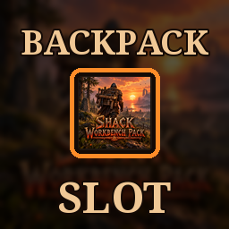

# Workbench Pack Extra Slots Bridge

**[Download on Thunderstore](https://thunderstore.io/c/valheim/p/TheShackDev/WorkbenchPack_ExtraSlots_Bridge/)** · version 1.0.0 · part of [The Shack Pack](https://thunderstore.io/c/valheim/p/TheShackDev/The_Shack_Pack/)

Gives the backpack from **[Shack Workbench Pack](https://thunderstore.io/c/valheim/p/TheShackDev/Shack_Workbench_Pack/)** its own **Backpack** slot in **[Extra Slots](https://thunderstore.io/c/valheim/p/shudnal/ExtraSlots/)**, so wearing it leaves your belt on.

## The problem

The workbench backpack is worn in the **utility slot**, the one Megingjord uses. In the base game that's one slot, so the backpack and the belt replace each other. That's by design.

With Extra Slots it looks like it should fit next to the belt, but:

- Extra Slots' extra utility slots are locked at first (by default until Bonemass is defeated or a Wishbone is found). Until then there is only the normal utility slot, so the backpack still takes the belt off.
- Once they unlock, the backpack shares them with rings, the Wishbone and the Demister.
- Putting it in Extra Slots' **Misc** slot list doesn't help: misc slots only store items, they never wear them.

## What it does

- Adds a **Backpack** equipment slot to Extra Slots' equipment panel. Only the workbench backpack fits.
- **Right-click** the backpack to wear it: it goes into the Backpack slot and your **belt stays on**.
- Everything the Workbench Pack does while worn works from that slot: the **bench on your back**, **Tab** to craft, the **build radius** around you and a packed-in **stonecutter**.
- **Packing up** a set-down bench (Shift+E) puts it back in the Backpack slot, even with a belt on (when the Workbench Pack's "Wear after packing up" is on, its default).
- Other players who have this bridge see the backpack on your back.
- The forge backpack is carried in the bag as before, and nothing else changes.

## How it works

The backpack gets an item type of its own that no vanilla slot accepts (the way shudnal's HipLantern gives its lantern a slot). The game still equips it with all its usual checks (broken, swimming, mid-attack...), so the backpack counts as worn, and the Workbench Pack itself is unchanged.

## Settings

In `BepInEx/config/theshack.workbenchpack_extraslots_bridge.cfg` (per player):

| Setting | Default | What it does |
|---|---|---|
| Backpack slot | true | Off: the backpack is a utility item again, as without this bridge. Restart the game after changing it. |
| Slot name | Backpack | The slot's name in the equipment panel. |
| Item type number | 57 | The backpack's own item type. Change it only if another mod uses the same number (HipLantern uses 56). Restart the game after changing it. |

## Notes

- **Client-side.** The server doesn't need it. Every player should have it to see backpacks on other players' backs.
- Needs Shack Workbench Pack and Extra Slots.
- Part of [The Shack Pack](https://thunderstore.io/c/valheim/p/TheShackDev/The_Shack_Pack/) since 1.1.0, which switched to Extra Slots (Extra Slots doesn't run alongside Equipment and Quick Slots).
- Tested with Extra Slots 1.2.21, Shack Workbench Pack 1.2.0, Jotunn 2.30.2, BepInExPack 5.4.2351, Valheim 1.0.20.

## Credits

Thanks to shudnal for Extra Slots and its custom slot API, and for showing the way with HipLantern. Thanks to the player who reported the problem.

## Building from source

You need the [.NET SDK](https://dotnet.microsoft.com/download) (6.0 or newer) and Valheim. The project compiles against your own copies of the game's DLLs, BepInEx, Jotunn and Extra Slots; none of them are in this repo.

```bash
dotnet build -c Release \
  -p:ValheimManaged="/path/to/Valheim/valheim_Data/Managed" \
  -p:ProfileRoot="/path/to/your/profile/BepInEx"
```

`ProfileRoot` is the `BepInEx` folder of any r2modman profile that has Jotunn and Extra Slots (it needs `core/`, `plugins/ValheimModding-Jotunn/` and `plugins/shudnal-ExtraSlots/`). Without the `-p:` options the project looks for a Linux Steam install and an r2modman profile named "The Shack Pack Test Environment". The DLL lands in `bin/Release/`.

This is the source of version 1.0.0 on Thunderstore.

## License

MIT, see [LICENSE](LICENSE).

*This mod was written with the help of an AI assistant (Claude).*
